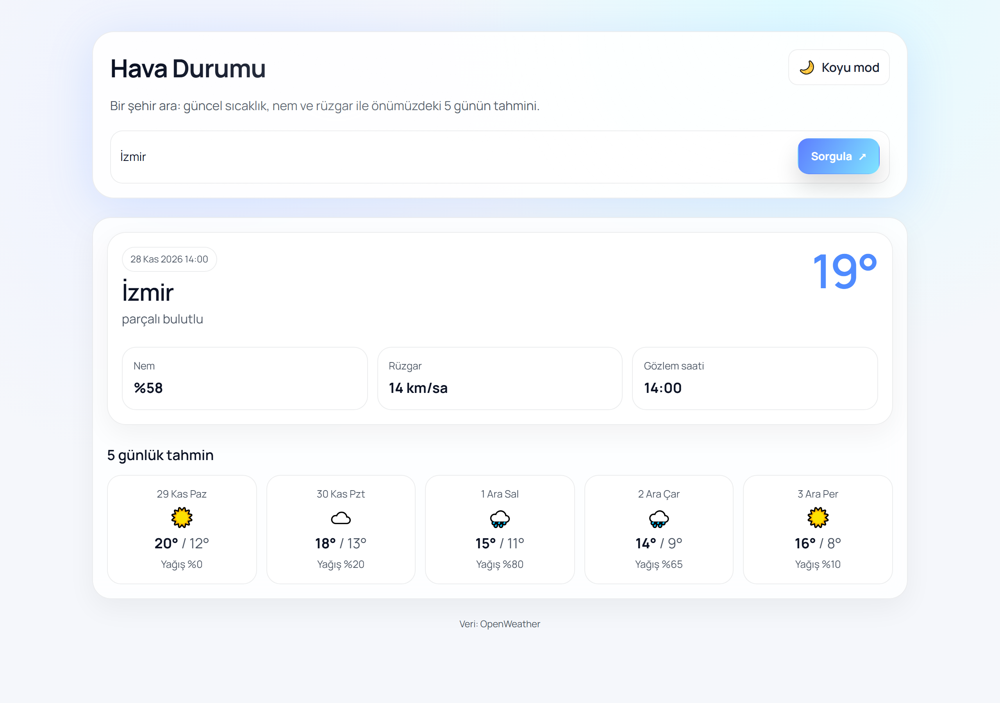
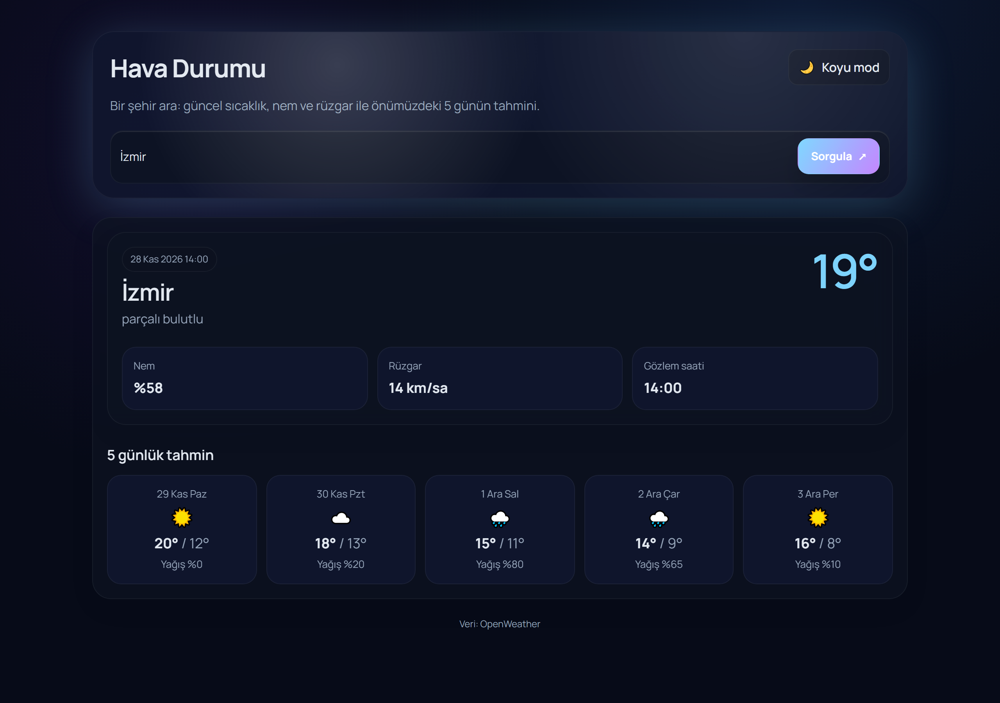
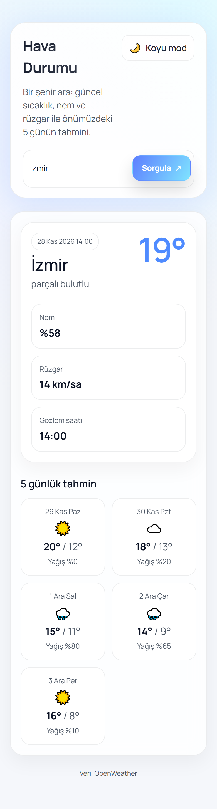
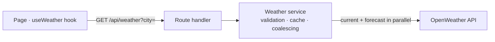

<div align="center">


# Weather Forecast

**Current weather and a five-day forecast for any city, in Turkish.**

**[Live demo → weather-forecast-app-gamma-seven.vercel.app](https://weather-forecast-app-gamma-seven.vercel.app)**

[](https://github.com/akifkeklik/weather-forecast-app/actions/workflows/ci.yml)
[](LICENSE)




</div>

<table>
<tr>
<td width="62%"></td>
<td width="38%"></td>
</tr>
</table>

<sub>Screenshots use sample data in place of a live API response.</sub>

## What it does

- Current temperature, condition, humidity, wind and observation time.
- **Five-day forecast:** daily low and high, condition and chance of rain, grouped by the city's own calendar day.
- Light and dark themes, phone layout, Turkish descriptions from the provider.

## How it is built



| Decision | Why |
|---|---|
| The API key stays on the server | The browser only talks to `/api/weather`; the key is never in client code. |
| Cache with TTL and LRU (500 cities) | Repeated searches do not cost provider calls. |
| Concurrent searches for one city share a request | Ten users searching "İzmir" at once make one provider call. At most 50 different cities in flight. |
| 8-second timeout, mapped errors | Provider failures become clear 4xx/5xx answers; raw provider messages and the key never leak. |
| Forecast failure does not hide current weather | Both calls run in parallel; if only the forecast fails, current weather is shown and that answer is not cached. |
| Days in the city's time zone | OpenWeather returns 3-hour UTC slots; they are grouped by the city's local date. Partial days are dropped rather than show a wrong low and high. |
| Stale responses are ignored | A new search cancels the previous request in the browser. |

## Run locally

Requires Node.js 24 and an [OpenWeather](https://openweathermap.org/api) key (the free plan covers both endpoints).

```bash
npm ci
cp .env.example .env.local   # set OPENWEATHER_API_KEY
npm run dev                  # http://localhost:3000
```

| Variable | Default | Purpose |
|---|---|---|
| `OPENWEATHER_API_KEY` | required | Provider key, server only |
| `WEATHER_CACHE_TTL_MINUTES` | `30` | Cache lifetime |
| `LOG_LEVEL` | `info` | `error`, `warn`, `info` or `debug` |

## API

`GET /api/weather?city=Izmir` returns current weather and `forecast` (empty if only the forecast call failed).

| Status | Meaning |
|---|---|
| `200` | Weather returned |
| `400` | Missing or invalid city |
| `404` | City not found |
| `429` | Provider rate limit |
| `502` | Provider unreachable or invalid response |
| `503` | Too many different cities in flight; retry |

## Tests

```bash
npm test && npm run lint && npm run typecheck && npm run build
```

25 tests on every pull request: forecast grouping by local day, the OpenWeather client (status mapping, no key in
errors, malformed data), cache expiry and eviction, request coalescing and the concurrency limit, the degraded path
when only the forecast fails, and the browser-side response check.

## Limits

The cache lives in one server process; several instances would need a shared cache such as Redis. No hourly view,
no location search by coordinates, no accounts.

## License

[MIT](LICENSE) · Built by [Akif Keklik](https://github.com/akifkeklik)
